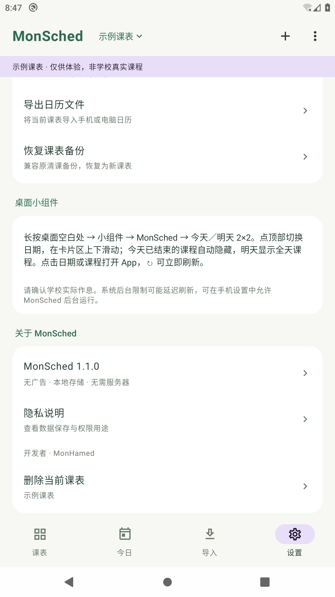
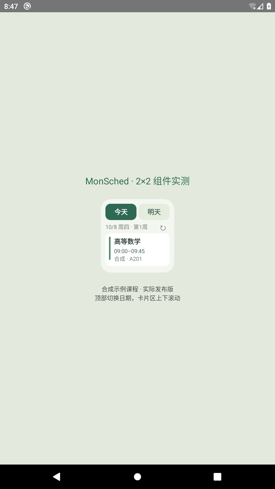
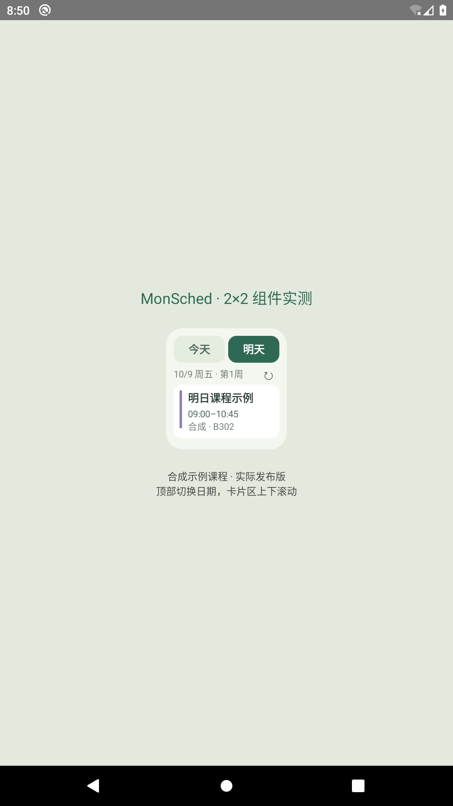

# MonSched · Android 课程表 1.2.0


无广告、开源的原生 Android 课程表，支持配置不同学校，优先适配正方教务，并提供通用文件导入。使用 Kotlin、Jetpack Compose 和 Room，无需自建服务器，不包含广告或统计 SDK。

开发者：**MonHamed** · [MIT 许可证](LICENSE) · [下载最新 APK](https://github.com/fading-rainbow/MonSched/releases/latest) · [验证记录](VALIDATION.md)

| 设置与开发者署名 | 今天的滚动组件 | 明天的课程 |
| --- | --- | --- |
|  |  |  |

## 安装与开始使用

1. 从 [GitHub Releases](https://github.com/fading-rainbow/MonSched/releases/latest) 下载 `MonSched-1.2.0.apk`，在 Android 手机上打开。支持 Android 8.0 及以上。已安装清课 1.0.0 或 MonSched 1.1.0 的手机直接覆盖更新，保留原有课表、作息和设置，请勿先卸载。
2. 按系统提示允许当前下载工具安装此 APK。
3. 在「设置 → 学期设置」中填写学校第一周的周一、学期周数和每天节数。
4. 在「设置 → 作息时间」中按学校实际作息修改。默认时间是可编辑的示例，并非学校官方时间。
5. 在「导入 → 设置学校与教务入口」填写学校名称、教务系统类型和学校公布的完整登录网址。青岛工学院可直接选择预设。之后点击「登录教务并导入」，进入学生课表页，选择学年学期并点击查询，再点击底部「读取课表」。
6. 核对导入预览的课程、周次、节次、教师和教室，选择追加或替换后保存。

青岛工学院预设入口 `http://jw.qit.edu.cn/jwglxt/xtgl/login_slogin.html` 来自学校官网与教务处官网的链接；首次安装可自行选择学校。旧版升级保留原入口。优先填写 HTTPS。其他仅提供 HTTP 的学校，需要在配置中明确勾选传输提示，且 HTTP 导航限于所配置的主机和端口。应用不忽略 HTTPS 证书错误。若学校限制网络访问，请使用学校允许的校园网或正常的校外访问方式。

## 学校与教务兼容范围

| 系统 / 方式 | 当前支持 | 实际边界 |
| --- | --- | --- |
| 正方新版 | 所选学期的结构化课表接口、不同域名和部署前缀、课表 HTML | 登录后需进入学生课表页；学校自定义接口可能需要适配 |
| 正方经典 | 有星期、周次与节次信息的 HTML 网格，包括合并单元格 | 不假定与新版接口相同 |
| 强智 | 常见 `kbcontent` 课表块、教师/教室标签、分隔的课程记录，以及兼容字段 JSON | 读取已打开页面，不调用未验证的强智私有接口 |
| 树维 / URP / 其他 | 通用课表 HTML 网格或明确列名的课程列表，同源框架页面 | Canvas、图片、跨域框架或学校独有页面不保证识别 |
| 通用文件 | CSV、Excel XLSX、JSON、HTML、ICS 日历 | 推荐使用 `samples/` 模板；PDF、图片和旧版二进制 XLS 暂不支持 |

解析已通过合成样本与真实 WebView 测试，不代表全部学校都已完成实际账号登录验证。没有提供学生账号，青岛工学院也未进行真实账户端到端测试。学校登录后的页面或统一认证存在额外差异时，可先用文件导入，并提交去除个人信息的样本以便继续适配。

## 已实现

- 周视图、周次选择、左右切换和滑动切周，自动计算当前周。
- 今日课程，显示正在上课、下一节课、上课时间和地点。
- 多张课表切换、新建、重命名和删除。
- 手动添加、编辑和删除课程时段，单个课程可添加多个独立时段。
- 单双周、任意指定周、课程颜色、备注和重叠课程显示。
- 学期开始日期、周数、每天节数和逐节作息设置。
- 周末显示开关、非本周课程显示开关、浅色/深色/系统主题。
- 学校名称、教务系统与官方入口配置，青岛工学院一键预设。
- 正方结构化 JSON、新旧课表 HTML、常见强智与通用列表解析；CSV / XLSX / JSON / HTML / ICS 文件导入，导入预览、选择时段和去重。
- 全量 JSON 备份和恢复；恢复为新课表，保留已有数据。
- 当前课表 CSV 导出、精确展开指定周次的 `.ics` 日历文件导出、整周 PNG 图片导出。
- 课前 5/10/15/30 分钟通知提醒，开机和日期/时区变化后重排。
- 新增 2×2「今天／明天」桌面组件，卡片列表可上下滚动，今天的课程结束后逐个隐藏，明天显示全天课程。
- 保留原有今日概览桌面组件，两种组件均跟随当前选中的课表。
- MonSched 新名称和机械日历、玫瑰主题插画图标。
- 设置页「关于 MonSched」显示开发者签名 MonHamed。
- 单独创建、明确标注的示例课表；首次安装不会混入示例课程。

## 提醒和桌面组件

在「设置 → 上课提醒」主动打开提醒。Android 13 及以上需要授予通知权限。提醒只使用当前选中的课表，并依据学期日期与作息时间计算。第一版使用系统允许的普通后台闹钟；系统省电模式和后台限制可能造成延迟。

长按手机桌面空白处，选择「小组件 → MonSched → 今天／明天 2×2」。Android 12 及以上默认建议占用 2×2 格；实际尺寸受手机桌面网格影响，可以长按调整大小。课程卡片区上下滑动，顶部按钮切换今天和明天，点击日期或课程打开 App，↻ 立即刷新。

今天只显示尚未结束的课程，正在上课时标注「上课中」。连排的第 1–2 节算一个课程卡片，在第 2 节结束后隐藏；不会删除 App 内的课程。明天显示全部课程，跨周时按明天的周次计算单双周。午夜后日期自动向前移动；多个组件分别保留各自的今天／明天选择。未确认开学日期或缺少有效作息时会提示设置，不猜测下课时间。

组件在课程开始、结束、午夜、课表修改、重启和时间／时区变更时更新，不依赖课前提醒开关。Android 12 及以上可在「设置 → 桌面小组件 → 下课时准时更新」中允许系统的「闹钟和提醒」权限。未允许时仍可使用组件，后台刷新可能延迟；手机自身的后台限制也可能影响更新，可允许 MonSched 后台运行。

## 文件导入

CSV 使用 UTF-8 编码，支持 Excel 常见的 GB18030 文本。表头如下：

```csv
课程名称,教师,教室,星期,开始节,结束节,周次,备注
高等数学,张老师,A201,1,1,2,1-16,带教材
大学英语,李老师,B302,3,3,4,1-16(单),仅单周
```

星期 `1-7` 表示周一到周日，也接受「周一」「星期一」。节次范围为 `1-16`，周次范围为 `1-40`。包含逗号或换行的字段应按 CSV 规则使用双引号。

也支持英文字段 `CourseName,Day,Sections,Weeks,Teacher,Room`，星期如 `Monday` / `Mon`。可用「节次」列替代开始节与结束节，填写 `1-2`；同一天多个独立时段如 `1-2,5-6` 会拆为两条课程记录。

### Excel XLSX

下载 [Excel 模板](samples/course-template.xlsx) 或 [CSV 模板](samples/course-template.csv)，替换为实际课程后导入。XLSX 表头与 CSV 相同，可识别共享字符串、内嵌字符串和多个工作表。课程数据应使用普通文本/数值；含公式的文件请先复制、粘贴为值。仅有彩色块或合并单元格的可视化周课表应另存为标准课程列表或 HTML，而非直接猜测节次。

### ICS 日历

ICS 使用实际日期和时间，导入前须确认第一周周一和真实作息。事件开始时间必须精确对应某节开始，结束时间对应某节结束；未匹配的事件会在预览中提示。使用 `SUMMARY`、`LOCATION`、`DESCRIPTION` / `X-TEACHER`；识别 UTC、IANA 时区和本地时间。支持展开的单次事件、按周或按日重复、`INTERVAL`、`COUNT`、`UNTIL`、非序号 `BYDAY`、`RDATE` 与 `EXDATE`。只导入当前学期内的课程。

全天事件、跨午夜课程、月/年重复、带 `RECURRENCE-ID` 的单次修改暂不映射，需先导出为展开的单次事件。MonSched 自己导出的 ICS 可按同一学期及作息重新导入。[日历样例](samples/calendar-example.ics) 使用 2026-09-07 为第一周、08:00–09:40 为第 1–2 节，仅供格式演示。

正方 JSON 支持 `kbList`，课程字段包括 `kcmc`、`xm`/`jsxm`、`cdmc`、`xqj`、`jcs`/`jcor` 和 `zcd`。也支持课程数组或 `{ "courses": [...] }`，使用 `name`、`teacher`、`room`、`weekday`、`startSection`、`endSection`、`weeks`、`color`、`note`。`weeks` 可为周次文本或整数数组；`sections` 可为文本或节次整数数组。兼容 `data`、`kbxx`、`rows` 中的数组及 `skjs`、`jxcdmc`、`zc` 等别名。

HTML 拒绝缺少周次、星期或无法区分课程的记录，并在预览中提示，不自动猜测这些信息。文件大小限 5 MB，XLSX 解压内容限 20 MB，课程列表限 3000 条。备份 JSON 应使用「恢复备份」，课表文件应使用「选择课表文件」。

## 本地数据与隐私

课程和设置保存在应用私有数据库与设置文件中。不会向个人服务器上传数据。不额外记录账号密码；退出教务导入页面会清除 WebView 会话、缓存与网页存储。提取脚本只读取课表表格与课表接口，不读取登录表单。

权限为教务登录所需的网络权限、用户主动开启的通知权限、重启后重新安排提醒与组件更新所需的开机广播，以及可选的准时组件更新「闹钟和提醒」权限。文件操作使用系统文件选择器，不申请全部存储或联系人/位置权限。

卸载会删除本地数据，请先通过「导出完整备份」保存备份。后续安装同一签名的新版本可以覆盖更新。

## 开发与构建

建议使用 Android Studio，安装 Android SDK 35，并使用 JDK 17 或 21。Gradle Wrapper 已包含，首次构建需要网络下载依赖。

克隆项目后，用 Android Studio 打开根目录并配置本机 SDK。命令行构建可设置 `ANDROID_HOME`，或在未提交的 `local.properties` 中配置 `sdk.dir`。GitHub Actions 会执行单元测试、Lint 和调试版构建。

```bash
./gradlew :app:assembleDebug
./gradlew :app:testDebugUnitTest
./gradlew :app:lintDebug
# 连接 Android 模拟器或手机；AppFlowTest 要求应用数据为空。
./gradlew :app:connectedDebugAndroidTest
```

调试 APK 位于 `app/build/outputs/apk/debug/`。调试版使用调试签名，安装官方发布版的设备须先备份数据；日常更新请使用 Releases 中的 APK。

发布版本需要你自己的签名配置，可复制 `signing.properties.example` 为 `signing.properties` 并填写本地密钥路径和口令。原开发者可使用私有签名备份中的 `signing.properties` 和 `signing/qingke-release.jks`，再执行：

```bash
./gradlew :app:assembleRelease
```

如果自行生成新密钥，可参考 `signing.properties.example`。要覆盖安装本次交付的版本，必须保留并使用同一份签名密钥。签名包含私钥和口令，请单独备份，勿提交到公开仓库。

公开仓库不包含发布私钥、签名口令、教务账号、本地数据库或个人课表。`samples/` 和组件截图使用合成课程。问题反馈请描述机型、Android 版本和复现步骤；教务页面样本请移除账号、密码和个人信息。

## 项目结构

- `data/`：Room 数据模型、数据库、学期/周次规则与应用状态。
- `ui/`：Compose 周课表、今日、导入、设置和编辑对话框。
- `importer/`：学校连接配置、教务网页读取、HTML/JSON/CSV/XLSX/ICS 解析、备份编码。
- `assets/read_timetable.js`：在登录会话内读取选择学期的课表。
- `exporter/`：日历与整周图片导出。
- `reminders/`：课前提醒计划与后台广播。
- `widget/`：今日概览、2×2 滚动组件、远程列表服务与下课时间计划。
- `src/test/`：周次、日期边界、解析、备份、日历和提醒单元测试。
- `src/androidTest/`：实际界面、WebView 提取及真实 AppWidgetHost 列表／系统下课闹钟测试。组件测试会在隔离模拟器中临时授予测试组件绑定权限。

界面和实现为本项目编写，参考课程表类应用的使用流程，没有依赖 WakeUp 的服务或广告 SDK。
